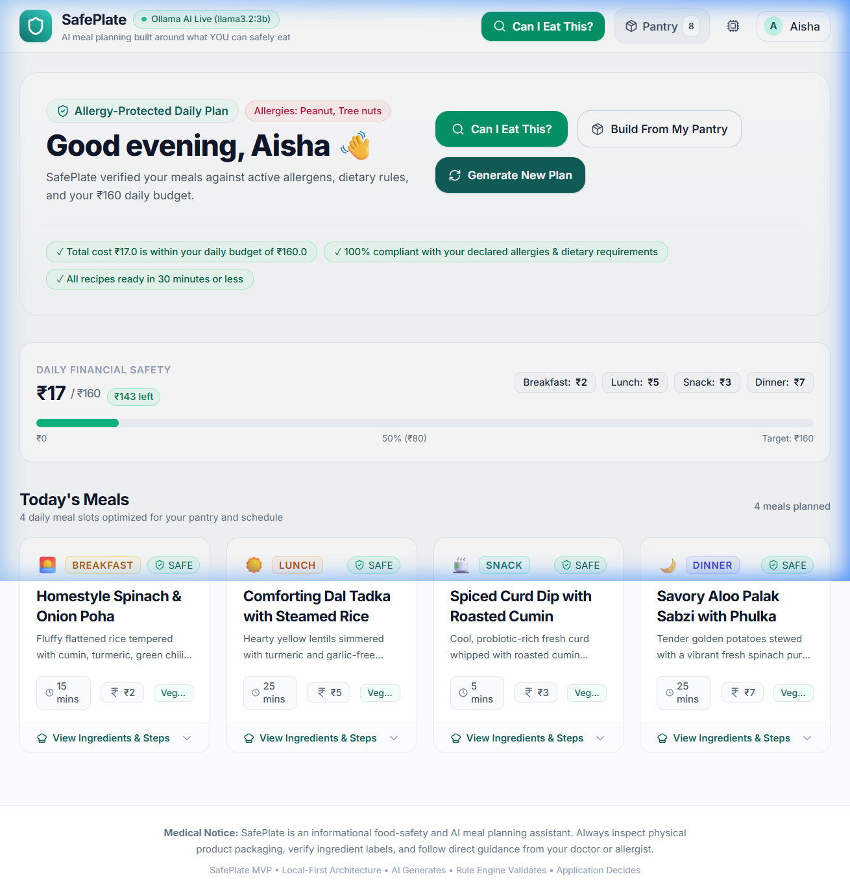
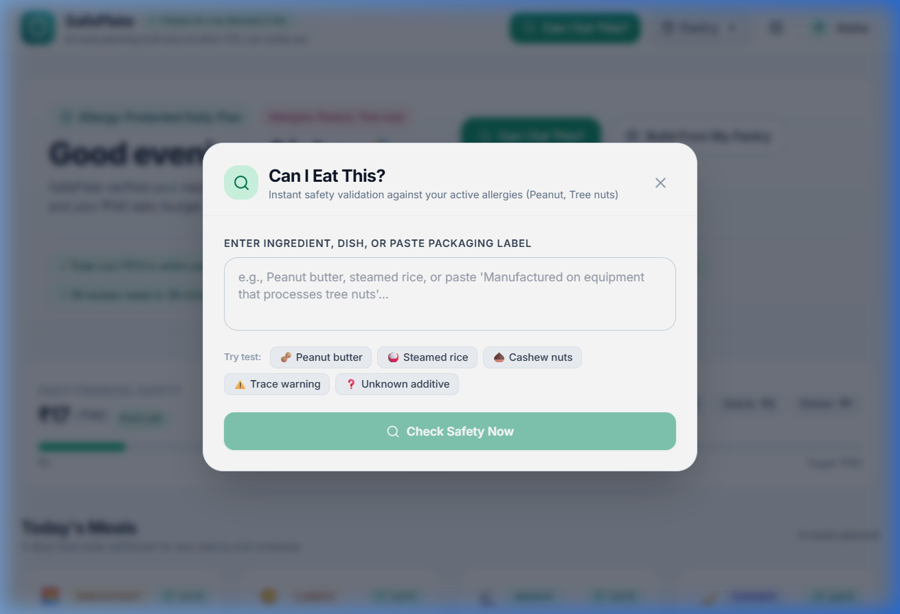
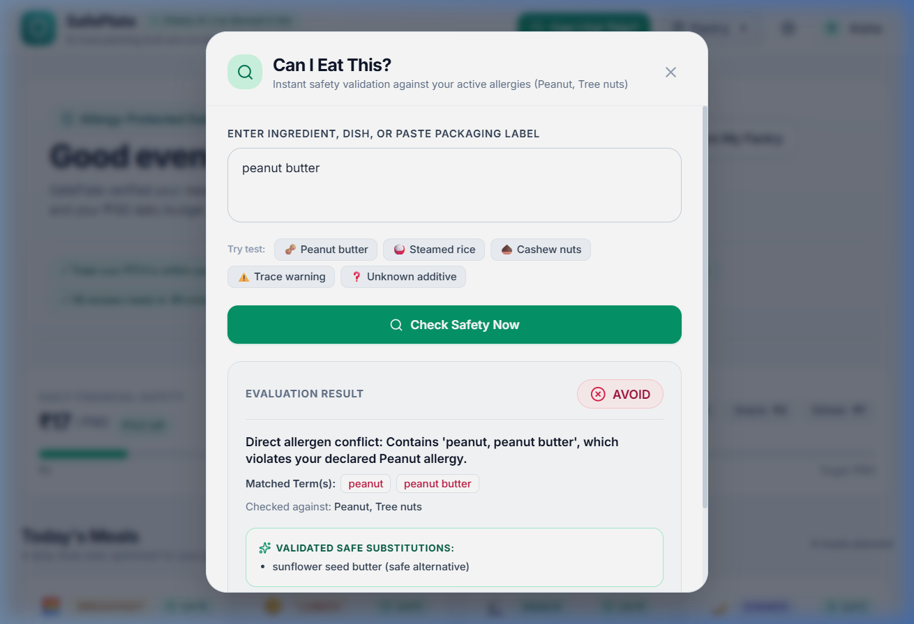
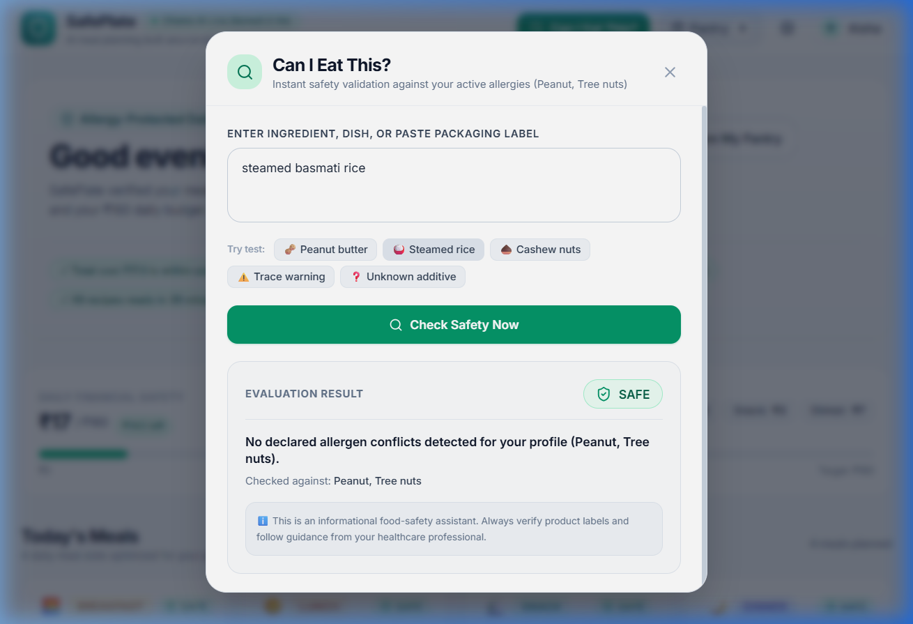
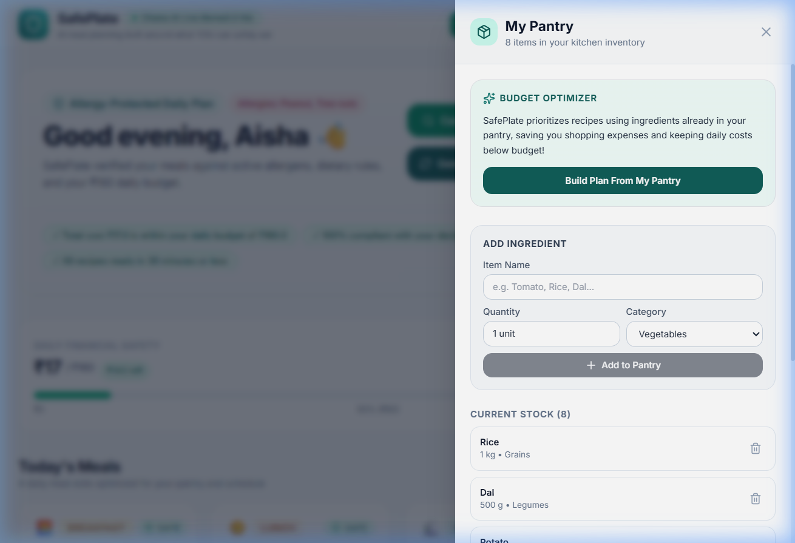
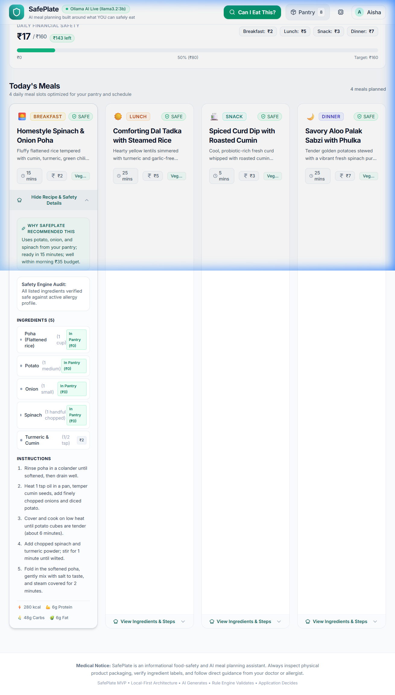
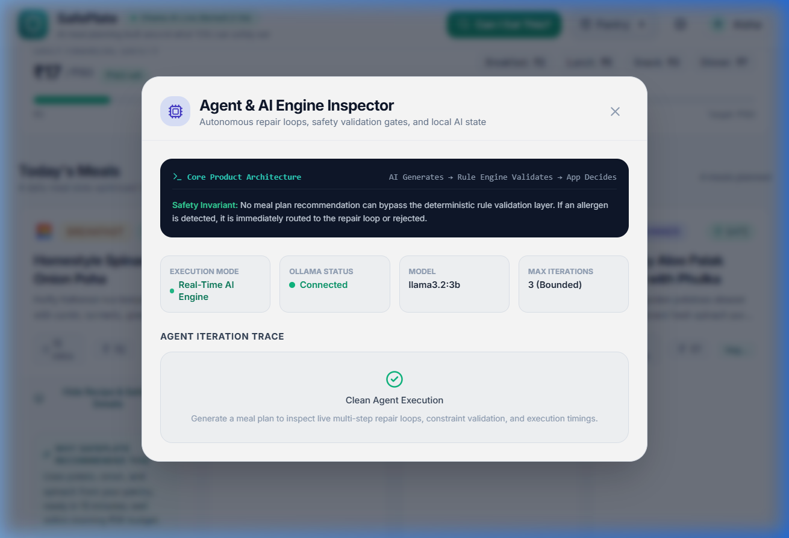

<p align="center">
  
</p>

<h1 align="center">🛡️ SafePlate — AI Meal Planning Built Around What YOU Can Safely Eat</h1>

<p align="center">
  <strong>Local-first · Privacy-respecting · Allergy-safe · Budget-conscious</strong>
</p>

<p align="center">
  <a href="#-key-features">Features</a> ·
  <a href="#-live-demo-screenshots">Screenshots</a> ·
  <a href="#-architecture">Architecture</a> ·
  <a href="#-quick-start">Quick Start</a> ·
  <a href="#-testing">Testing</a> ·
  <a href="#-contributing">Contributing</a>
</p>

<p align="center">
  
  
  
  
  
  
  
</p>

---

## 🧠 What is SafePlate?

SafePlate is a **local-first, privacy-respecting, allergy-safe meal planning application** and **instant food safety checker**. It is built for anyone managing:

- 🥜 **Serious food allergies** (peanuts, tree nuts, sesame, etc.)
- 🥗 **Strict dietary preferences** (vegetarian, vegan, non-vegetarian)
- 💰 **Daily financial constraints** (e.g., ₹150/day budget)
- ⏱️ **Busy schedules** (under 30-minute cooking time)

Unlike generic chatbots or thin AI wrappers, SafePlate enforces a **strict non-negotiable architectural invariant**:

> ### 🔒 AI GENERATES. RULE ENGINE VALIDATES. APPLICATION DECIDES.

The AI is **never** trusted as the final authority on food safety. A deterministic, multi-layered rule engine validates every single suggestion before it reaches you.

---

## ✨ Key Features

### 1. 🔬 Deterministic Food Safety Knowledge Engine
- Classifies every food item into **`SAFE`**, **`CAUTION`**, **`AVOID`**, or **`UNKNOWN`**
- Handles allergen synonyms and culinary terms (groundnut → peanut, badam → almond, kaju → cashew, dahi → curd)
- Detects cross-contamination warnings (*"may contain traces of peanuts"* → **`CAUTION`**)
- Unknown/unverified additives trigger **`UNKNOWN`** — never hallucinated as safe

### 2. 🍽️ "Can I Eat This?" Instant Safety Validator
- Check raw ingredients, dish names, or paste packaged grocery product labels
- Immediate deterministic verdict with clear rationale and matched allergen terms
- Provides validated safe substitutions on direct allergen conflicts

### 3. 🔄 Smart Ingredient Substitution Loop
- Automatically attempts up to 3 culinary substitutes when an unsafe ingredient is detected
- **Invariant**: An unvalidated substitution can **NEVER** become final

### 4. 🛒 Pantry-Aware Budget Optimization
- Prioritizes ingredients already in your kitchen (₹0 added cost)
- Deterministic budget validation guarantees total cost never exceeds your daily budget

### 5. 🤖 Bounded Agentic Repair Loop
- Multi-layer constraint pipeline: Normalization → Allergy Engine → Contamination Check → Diet Validation → Budget Validation → Cooking Time → Quality Gate
- Bounded to `MAX_ITERATIONS = 3` — never runs away
- Honest failure handling with actionable recovery options

### 6. 🏠 Local-First & Open-Source AI
- Powered by **Ollama** running open-weight models (Llama 3.2, Mistral, Qwen)
- Your medical allergy profile **never leaves your machine**
- Built-in **deterministic demo mode** for offline demonstrations

### 7. 🔄 Automatic Allergy Invalidation
- Editing allergies immediately invalidates previous meal plans
- Obsolete recommendations are **never** consumed

---

## 📸 Live Demo Screenshots

<details>
<summary><b>🖥️ Main Dashboard — Personalized Meal Plan</b></summary>
<br/>

<p><em>Personalized greeting, active allergy tags, daily financial tracker, and 4-meal plan with safety badges.</em></p>
</details>

<details>
<summary><b>🛡️ "Can I Eat This?" — Instant Safety Modal</b></summary>
<br/>

<p><em>Interactive safety checker with quick-test buttons for common allergens.</em></p>
</details>

<details>
<summary><b>🚫 AVOID Result — Peanut Butter Detection</b></summary>
<br/>

<p><em>Instant red AVOID badge with matched allergen terms and validated safe substitutes.</em></p>
</details>

<details>
<summary><b>✅ SAFE Result — Steamed Rice Verification</b></summary>
<br/>

<p><em>Green SAFE badge confirming no allergen conflicts detected.</em></p>
</details>

<details>
<summary><b>🛒 Pantry Manager</b></summary>
<br/>

<p><em>Kitchen inventory with add-item form and one-click pantry-optimized plan builder.</em></p>
</details>

<details>
<summary><b>📖 Recipe Details & Nutrition</b></summary>
<br/>

<p><em>Expanded meal card showing ingredients, cooking steps, pantry price flags, and macronutrient breakdown.</em></p>
</details>

<details>
<summary><b>🤖 Agent & AI Engine Inspector</b></summary>
<br/>

<p><em>Real-time view of the bounded agentic loop: AI Generates → Rule Engine Validates → App Decides.</em></p>
</details>

---

## 🏗️ Architecture

```
┌─────────────────────────────────────────────────────────────┐
│           User / Browser (React 19 + Tailwind CSS)          │
│                    + Framer Motion Animations                │
└────────────────────────────┬────────────────────────────────┘
                             │ REST API
                             ▼
┌─────────────────────────────────────────────────────────────┐
│            FastAPI Local REST API (Python 3.13)              │
│                    + Pydantic v2 Schemas                     │
└────────────────────────────┬────────────────────────────────┘
                             │
                             ▼
┌─────────────────────────────────────────────────────────────┐
│              SQLite Database (SQLAlchemy 2.0)                │
│   user_profiles │ allergies │ pantry_items │ meal_plans      │
│   meals │ meal_ingredients │ safety_checks │ agent_runs      │
└────────────────────────────┬────────────────────────────────┘
                             │
                             ▼
┌─────────────────────────────────────────────────────────────┐
│        Deterministic Safety & Validation Pipeline            │
│                                                              │
│  ┌──────────────┐ ┌───────────────┐ ┌────────────────────┐  │
│  │Allergy Engine│ │Diet Validator │ │Budget & Pantry Eng.│  │
│  └──────────────┘ └───────────────┘ └────────────────────┘  │
│  ┌──────────────┐ ┌───────────────┐ ┌────────────────────┐  │
│  │Time Validator│ │Quality Gate   │ │Substitution Engine │  │
│  └──────────────┘ └───────────────┘ └────────────────────┘  │
└────────────────────────────┬────────────────────────────────┘
                             │
                             ▼
┌─────────────────────────────────────────────────────────────┐
│          Bounded Agent Repair Loop (Max 3 Iterations)        │
└────────────────────────────┬────────────────────────────────┘
                             │
                             ▼
┌─────────────────────────────────────────────────────────────┐
│        AI Provider Abstraction (AIProvider ABC)              │
│                                                              │
│  ┌──────────────────────┐  ┌─────────────────────────────┐  │
│  │   OllamaProvider     │  │    DemoProvider              │  │
│  │   (Local LLM via     │  │    (Zero-dependency          │  │
│  │    HTTP :11434)       │  │     deterministic mode)      │  │
│  └──────────────────────┘  └─────────────────────────────┘  │
└─────────────────────────────────────────────────────────────┘
```

### Core Design Principle

The **AI is never trusted** as the final authority. Every AI-generated meal plan passes through a deterministic, multi-layered validation pipeline:

1. **Candidate Generation** — AI proposes a meal plan
2. **Structured Extraction** — Pydantic schema validation
3. **Ingredient Normalization** — Lowercase, punctuation removal, alias expansion
4. **Allergy Knowledge Engine** — Direct allergen check (SAFE/CAUTION/AVOID/UNKNOWN)
5. **Cross-Contamination Check** — Trace warnings & shared equipment detection
6. **Diet Validation** — Vegetarian/Vegan/Non-Veg compliance
7. **Pantry Optimization** — Match pantry items, calculate added cost
8. **Budget Validation** — Deterministic sum ≤ daily budget
9. **Cooking Time Validation** — Each meal ≤ max cooking time
10. **Quality Gate** — Step counts, ingredient counts, nutrition tags
11. **Repair or Accept** — Violations trigger bounded repair loop (max 3 iterations)

---

## 🚀 Quick Start

### Prerequisites

| Tool | Version | Required? |
|------|---------|-----------|
| **Python** | 3.11+ | ✅ Yes |
| **Node.js** | 18+ | ✅ Yes |
| **Git** | Latest | ✅ Yes |
| **Ollama** | Latest | ⬜ Optional (Demo mode works without it) |

### 1. Clone the Repository

```bash
git clone https://github.com/MDADILIFTEKHAR/SafePlate.git
cd SafePlate
```

### 2. Set Up the Backend (Python)

```bash
# Create and activate virtual environment
python -m venv .venv

# Windows PowerShell:
.\.venv\Scripts\pip install -r backend/requirements.txt

# macOS / Linux:
source .venv/bin/activate
pip install -r backend/requirements.txt
```

### 3. Set Up the Frontend (React)

```bash
cd frontend
npm install
cd ..
```

### 4. Configure Environment

```bash
cp .env.example .env
```

Default `.env` settings:
```env
DEMO_MODE=false              # Set to true for offline demo mode
MODEL_PROVIDER=ollama
MODEL_NAME=llama3.2:3b
OLLAMA_BASE_URL=http://localhost:11434
DATABASE_URL=sqlite:///./safeplate.db
MAX_AGENT_ITERATIONS=3
```

### 5. Run the Application

**Terminal 1 — Backend API:**
```bash
# Windows PowerShell:
$env:PYTHONPATH='backend'
.\.venv\Scripts\python -m uvicorn app.main:app --host 127.0.0.1 --port 8000 --reload

# macOS / Linux:
PYTHONPATH=backend .venv/bin/python -m uvicorn app.main:app --host 127.0.0.1 --port 8000 --reload
```

**Terminal 2 — Frontend Client:**
```bash
cd frontend
npm run dev
```

### 6. Open in Browser

| Service | URL |
|---------|-----|
| 🖥️ **Frontend App** | [http://localhost:5173](http://localhost:5173) |
| 📡 **Backend API** | [http://127.0.0.1:8000](http://127.0.0.1:8000) |
| 📖 **API Documentation** | [http://127.0.0.1:8000/docs](http://127.0.0.1:8000/docs) |

---

## 🦙 Running with Ollama (Live AI)

1. Install Ollama from [ollama.com](https://ollama.com)
2. Pull your chosen model:
   ```bash
   ollama pull llama3.2:3b
   ```
3. Start the Ollama daemon:
   ```bash
   ollama serve
   ```
4. Configure `.env`:
   ```env
   DEMO_MODE=false
   MODEL_PROVIDER=ollama
   MODEL_NAME=llama3.2:3b
   ```
5. Restart the backend — the UI badge will display **"Ollama AI Live (llama3.2:3b)"**

### Supported Models

| Model | Command | Size | Notes |
|-------|---------|------|-------|
| **Llama 3.2 3B** (recommended) | `ollama pull llama3.2:3b` | ~2 GB | Best balance of speed & quality |
| Mistral 7B | `ollama pull mistral:7b` | ~4 GB | Strong reasoning |
| Qwen 2.5 7B | `ollama pull qwen2.5:7b` | ~4.5 GB | Excellent multilingual |

---

## 🧪 Testing

SafePlate includes a comprehensive multi-tier test suite:

| Tier | Description | Tool |
|------|-------------|------|
| **Unit Tests** | Allergy engine, normalization, budget, cooking time, substitutions | Pytest |
| **Invariant Tests** | Property-based tests enforcing safety guarantees | Pytest |
| **Integration Tests** | API endpoints, concurrency, database persistence, invalidation | Pytest |
| **Frontend Tests** | Component rendering, modal state, accessibility | Vitest |
| **E2E Tests** | Full browser flow testing the complete user journey | Playwright |

### Run Tests

```bash
# Backend unit & integration tests
# Windows:
$env:PYTHONPATH='backend'
.\.venv\Scripts\pytest backend/tests -v

# macOS / Linux:
PYTHONPATH=backend .venv/bin/pytest backend/tests -v

# Frontend unit tests
cd frontend
npm run test

# End-to-end tests
npx playwright test
```

---

## 📁 Project Structure

```
SafePlate/
├── backend/
│   ├── app/
│   │   ├── api/endpoints/       # REST API route handlers
│   │   ├── core/config.py       # Pydantic settings & environment
│   │   ├── database/            # SQLAlchemy models & session
│   │   ├── models/              # Database ORM models
│   │   ├── schemas/             # Pydantic request/response schemas
│   │   ├── services/
│   │   │   ├── agent/           # Bounded agentic repair loop
│   │   │   ├── ai/              # AI provider abstraction (Ollama/Demo)
│   │   │   ├── budget/          # Budget & pantry optimization engine
│   │   │   ├── meal/            # Meal planning & time validation
│   │   │   └── safety/          # Deterministic allergy knowledge engine
│   │   └── main.py              # FastAPI application entry point
│   ├── tests/                   # Pytest test suites
│   └── requirements.txt         # Python dependencies
├── frontend/
│   ├── src/
│   │   ├── components/          # React UI components
│   │   │   ├── AgentInspectorModal.jsx
│   │   │   ├── BudgetTracker.jsx
│   │   │   ├── CanIEatModal.jsx
│   │   │   ├── MealCard.jsx
│   │   │   ├── Navbar.jsx
│   │   │   ├── PantryDrawer.jsx
│   │   │   ├── ProfileModal.jsx
│   │   │   └── SafetyBadge.jsx
│   │   ├── pages/HomePage.jsx   # Main dashboard page
│   │   ├── services/            # API client services
│   │   └── App.jsx              # Root application component
│   ├── tests/                   # Vitest test suites
│   └── package.json             # Node.js dependencies
├── data/
│   ├── allergens.json           # Allergen taxonomy database
│   ├── ingredient_aliases.json  # Culinary synonym mappings
│   ├── sample_foods.json        # Sample food database
│   └── substitutions.json       # Safe substitution candidates
├── e2e/                         # Playwright end-to-end tests
├── docs/screenshots/            # Application screenshots
├── .env.example                 # Environment configuration template
├── ARCHITECTURE.md              # Detailed technical architecture
├── SECURITY.md                  # Security & privacy documentation
├── OPEN_SOURCE.md               # Open-source AI integration guide
├── DEMO_SCRIPT.md               # Live demonstration walkthrough
└── TROUBLESHOOTING.md           # Common issues & solutions
```

---

## 🔒 Security & Privacy

SafePlate is engineered with **privacy-by-design**:

- **🚫 Zero Cloud Exfiltration** — Your allergy profiles, medical data, and pantry inventory never leave your machine
- **🏠 Local AI Execution** — Open-weight inference runs entirely on your host via Ollama
- **🔐 SQL Injection Protected** — All queries use SQLAlchemy ORM with parameterized bindings
- **🛡️ LLM Output Sandboxed** — AI responses are parsed as declarative JSON data only; no code execution
- **⏱️ Bounded Execution** — Agent loops enforce `MAX_ITERATIONS = 3` preventing runaway resource use
- **🔒 No Telemetry** — Zero analytics trackers, third-party cookies, or external data collection

For the full security architecture, see [SECURITY.md](SECURITY.md).

---

## 🛠️ Tech Stack

| Layer | Technology |
|-------|-----------|
| **Frontend** | React 19, Tailwind CSS 3.4, Framer Motion, Lucide Icons |
| **Backend** | Python 3.13, FastAPI, Pydantic v2, SQLAlchemy 2.0 |
| **Database** | SQLite (local-first, zero-config) |
| **AI Engine** | Ollama (Llama 3.2, Mistral, Qwen) |
| **Testing** | Pytest, Vitest, Playwright |
| **Build Tool** | Vite 8 |

---

## 🤝 Contributing

Contributions are welcome! Here's how to get started:

1. **Fork** the repository
2. **Create** a feature branch:
   ```bash
   git checkout -b feature/your-feature-name
   ```
3. **Make** your changes and add tests
4. **Run** the test suite to ensure everything passes:
   ```bash
   # Backend
   $env:PYTHONPATH='backend'
   .\.venv\Scripts\pytest backend/tests -v

   # Frontend
   cd frontend && npm run test
   ```
5. **Commit** with a descriptive message:
   ```bash
   git commit -m "feat: add your feature description"
   ```
6. **Push** and open a Pull Request:
   ```bash
   git push origin feature/your-feature-name
   ```

---

## 📜 License

This project is licensed under the **MIT License** — see the [LICENSE](LICENSE) file for details.

---

## ⚠️ Medical & Safety Disclaimer

> **SafePlate is an informational food-safety and AI meal planning assistant. It is NOT a medical device.** Always inspect physical product packaging, verify ingredient labels, and consult with a qualified allergist or medical healthcare professional before consuming any food. SafePlate's safety classifications are provided as-is and should be used as one layer in a multi-layer food safety verification process.

---

<p align="center">
  Made with ❤️ for food allergy safety
  <br/>
  <strong>⭐ Star this repo if SafePlate helps keep you safe! ⭐</strong>
</p>
